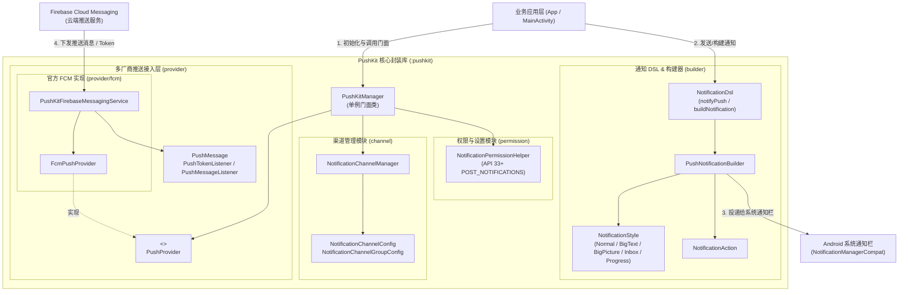

# PushKit - Android 通知与多厂商推送封装库

`PushKit` (Android) 是一套专为 Android 生态打造的高性能、轻量、高可扩展的通知与多厂商推送封装库，采用纯 Kotlin 开发。提供简洁直观的 **Kotlin DSL** 通知构建器、**Android 8.0+ 通知渠道管理**、**Android 13+ 动态通知权限辅助** 以及 **FCM / 厂商推送统一抽象接口**。

---

## 🌟 核心特性

- 🚀 **声明式 Kotlin DSL**：通过 `context.notifyPush { ... }` 极简语法创建和发送通知，告别冗长的原生 Builder。
- 📢 **通知渠道全生命周期治理 (`NotificationChannelManager`)**：一键创建、更新、查询、删除渠道与渠道组，统一控制优先级、提示音、震动模式、呼吸灯与锁屏可见性。
- 🛡️ **Android 13+ 运行时权限支持 (`NotificationPermissionHelper`)**：平滑适配 API 33+ `POST_NOTIFICATIONS` 运行时权限与全局通知开关检测，内置一键直跳系统应用通知设置页。
- 🔒 **Android 12+ 安全规范适配**：底层自动安全适配 `PendingIntent` 的 `FLAG_IMMUTABLE` / `FLAG_MUTABLE` 标志位。
- 🎨 **开箱即用的丰富展示样式**：
  - 普通通知 (`Normal`)
  - 长文本展开样式 (`BigText`)
  - 大图预览样式 (`BigPicture`)
  - 收件箱/多行列表样式 (`Inbox`)
  - 确定/不确定进度条通知 (`Progress`)
- 🔌 **多厂商推送通道解耦 (`PushProvider`)**：原生内置 Google 官方 **FCM (Firebase Cloud Messaging)** 通道实现，架构已解耦，可零侵入快速横向扩展华为、小米、OPPO、vivo、荣耀等厂商通道。
- 📱 **完整 Compose 演示工程 (`:sample`)**：包含基于 Jetpack Compose 打造的完整示例 App，方便直接体验与调试。

---

## 🛠️ 项目结构

```
PushKit-Android/
├── pushkit/                                  # 核心 Android 库模块 (:pushkit)
│   └── src/main/java/com/kit/push/
│       ├── PushKitManager.kt                 # 统一门面单例类
│       ├── channel/                          # 通知渠道 (NotificationChannel) 管理器与配置
│       ├── permission/                       # Android 13+ 权限检测与系统设置辅助
│       ├── builder/                          # Kotlin DSL、链式构建器与样式定义
│       └── provider/                         # 统一厂商推送抽象与数据模型
│           └── fcm/                          # 官方 FCM 通道与后台消息 Service 实现
├── sample/                                   # 示例演示模块 (Jetpack Compose)
└── gradle/
    └── android-library-publish.gradle.kts    # JitPack / MavenLocal 通用发布脚本
```

---

## 📐 代码架构图解



---

## 🚀 第三方快速接入指南

### 1. 依赖配置

#### 步骤 A：配置仓库地址
在你的项目根目录 `settings.gradle.kts` 的 `dependencyResolutionManagement` 中添加 JitPack 源：

```kotlin
dependencyResolutionManagement {
    repositories {
        google()
        mavenCentral()
        maven { url = uri("https://jitpack.io") }
    }
}
```

> 💡 **私有仓库提示**：若拉取权限受限，可在 [jitpack.io/private](https://jitpack.io/private) 登录授权生成 Token，并在配置中加入 `credentials { username = "YOUR_JITPACK_AUTH_TOKEN" }`。

#### 步骤 B：添加依赖
在业务模块（如 `app/build.gradle.kts`）中引入依赖：

```kotlin
dependencies {
    // 引入 PushKit 核心库
    implementation("com.github.e-hai:PushKit-Android:1.0.0")
}
```

---

### 2. 初始化与通知渠道配置

在 `Application.onCreate` 或首页 `MainActivity` 中完成通用渠道初始化：

```kotlin
import com.kit.push.PushKitManager
import com.kit.push.channel.NotificationChannelConfig
import android.app.NotificationManager

val pushKit = PushKitManager.getInstance(context)

// 创建普通消息渠道
pushKit.createChannel(
    NotificationChannelConfig(
        id = "channel_general",
        name = "普通消息提醒",
        description = "用于接收日常应用消息与系统提醒",
        importance = NotificationManager.IMPORTANCE_DEFAULT
    )
)

// 创建高优先级紧急渠道
pushKit.createChannel(
    NotificationChannelConfig(
        id = "channel_urgent",
        name = "重要告警通知",
        description = "用于高优先级紧急提醒",
        importance = NotificationManager.IMPORTANCE_HIGH,
        enableLights = true,
        enableVibration = true
    )
)
```

---

### 3. 发送本地通知 (使用 Kotlin DSL)

#### 基础文本通知 (带点击跳转 Intent)
```kotlin
import com.kit.push.builder.notifyPush
import com.kit.push.builder.createPendingActivityIntent

val intent = Intent(context, MainActivity::class.java)
// createPendingActivityIntent 会自动处理 Android 12+ (API 31+) FLAG_IMMUTABLE
val pendingIntent = context.createPendingActivityIntent(requestCode = 101, intent = intent)

context.notifyPush(id = 1001, channelId = "channel_general") {
    title = "新订单提醒"
    content = "您有一个新的外卖订单已接单！"
    contentIntent = pendingIntent
    autoCancel = true
}
```

#### 长文本展开通知 (`BigTextStyle`)
```kotlin
context.notifyPush(id = 1002, channelId = "channel_general") {
    title = "系统升级维护公告"
    content = "展开查看升级详细日志..."
    style = NotificationStyle.BigText(
        bigText = "我们将在今晚 02:00 ~ 04:00 进行例行系统升级，升级期间部分网络请求可能短暂受影响，请提前保存好您的数据。",
        summaryText = "系统公告"
    )
}
```

#### 大图画廊通知 (`BigPictureStyle`)
```kotlin
context.notifyPush(id = 1003, channelId = "channel_general") {
    title = "精彩图文推送"
    content = "长按或下拉通知栏展开大图"
    style = NotificationStyle.BigPicture(
        picture = bannerBitmap,
        summaryText = "图片预览"
    )
}
```

#### 进度条通知 (`ProgressStyle`)
```kotlin
context.notifyPush(id = 1004, channelId = "channel_general") {
    title = "安装包下载中"
    content = "正在下载更新包 (65%)"
    ongoing = true // 常驻通知，防止被意外划走
    style = NotificationStyle.Progress(
        max = 100,
        progress = 65,
        indeterminate = false
    )
}
```

---

### 4. Android 13+ 权限检查与设置管理

```kotlin
// 1. 检查是否有发送通知权限（兼容判断 Android 13+ POST_NOTIFICATIONS 与系统全局开关）
val hasPermission = PushKitManager.getInstance(context).hasNotificationPermission()

// 2. 引导用户直接跳转至本应用的系统通知设置页面
PushKitManager.getInstance(context).openNotificationSettings()

// 3. 一键清空所有已展示的通知
PushKitManager.getInstance(context).cancelAll()
```

---

### 5. 接入官方 FCM 远端推送

`PushKit` 原生内置了 FCM 通道封装：

```kotlin
import com.kit.push.PushKitManager
import com.kit.push.provider.fcm.FcmPushProvider

// 1. 实例化 FCM 通道并绑定事件回调
val fcmProvider = FcmPushProvider().apply {
    setMessageListener { message, providerName ->
        Log.d("PushKit", "收到来自 [$providerName] 的推送: id=${message.id}, title=${message.title}, payload=${message.payload}")
        
        // 如果是后台数据/透传消息，可手动触发 PushKit 本地弹窗：
        context.notifyPush(id = 2001, channelId = "channel_general") {
            title = message.title ?: "新消息"
            content = message.content ?: "有一条新的推送到达"
            autoCancel = true
        }
    }
}

// 2. 注册 FCM 通道（会自动请求并刷新 FCM Token）
PushKitManager.getInstance(context).registerProvider(fcmProvider)
```

> 💡 **项目接入配置**：业务工程主模块根目录下放入 Firebase Console 下载的 `google-services.json`，并应用 `com.google.gms.google-services` 插件即可。

---

## ⚙️ 编译与测试

```bash
# 编译库模块
./gradlew :pushkit:assembleRelease

# 编译并运行测试 Demo App
./gradlew :sample:assembleDebug
```

---

## 📄 License

本项目采用 MIT 许可证，详情参见 LICENSE 文件。
